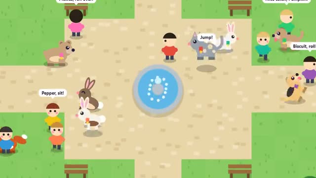

# Pet Park

Adopt a pet, teach it tricks, show it off. A multiplayer starter game from [Multiplayer Agent](https://multiplayeragent.com): 2D, drop-in, 2–20 players, with bot owners who walk their pets until people arrive.

## How it plays

Pick and name a pet, then play fetch, feed it and teach it tricks to level it up. Show off in the park: other owners cheer your pet and you can cheer theirs. Your pet and its tricks are saved for next time.

**Controls:** Tap or click to walk, Throw then tap the grass, tap a pet to cheer it; WASD, F to throw, E to feed, T for tricks.

## Make it yours in the Game Builder

Open the [Game Builder](https://multiplayeragent.com), choose **Start from a starter game** and pick Pet Park. It opens as version 1 in your studio, ready to play and publish. Then ask for changes, for example:

- Add a dog show where pets compete with tricks
- Let pets wear hats and bandanas
- Add a frisbee that two pets can chase

## Run it yourself

1. Get a free publishable key (`pk_…`) at [multiplayeragent.com](https://multiplayeragent.com).
2. In `index.html`, put it in place of `pk_REPLACE_ME` in the `MP_CONNECT` block.
3. Open `index.html` in a browser. No build step and no server needed.

Without a key it still runs, offline with bot owners, and keeps your pet in this browser.

## How it is built

- One `index.html`. The comment at the top of the script maps the code and explains the multiplayer.
- **Saves:** Your pet's looks, name, XP, level and tricks are saved to your player (and to this browser), so it is waiting for you next time.
- **Bots:** Bot owners walk their pets, play fetch, show off tricks and come over to cheer yours until people arrive.
- **Host-run rules:** The host's browser hides bones in the grass and decides whose pet sniffed out each one. If it leaves, the next player takes over.
- **Live sync:** Everyone sees every pet run, fetch and do its tricks.
- **Leaderboard:** The pets with the most XP, under the Top button.
- **Live ops:** Turn on double XP (`xpBoost`) from the live config, with no new deploy. A running live event's title shows on screen.
- `?attract` runs it offline with bots only. The preview video is recorded from it.

## License

MIT.
